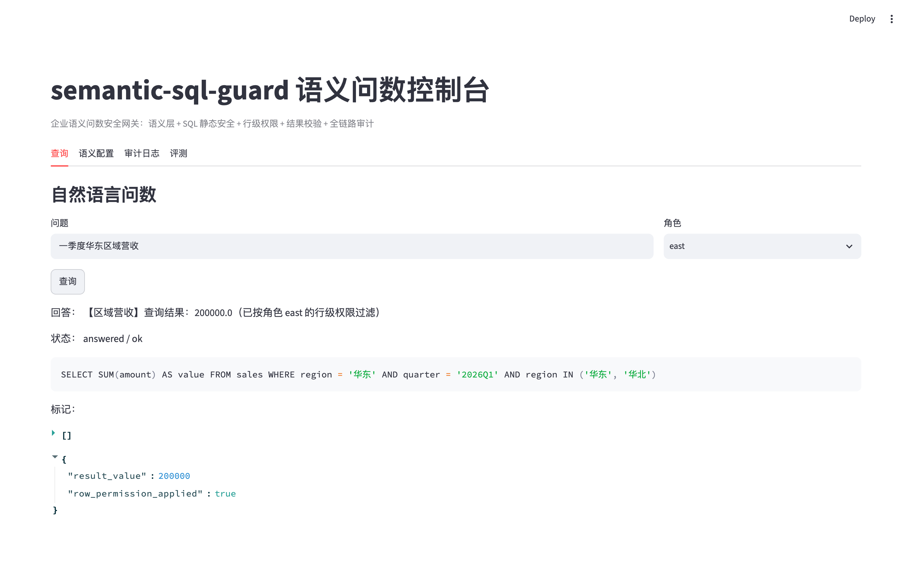
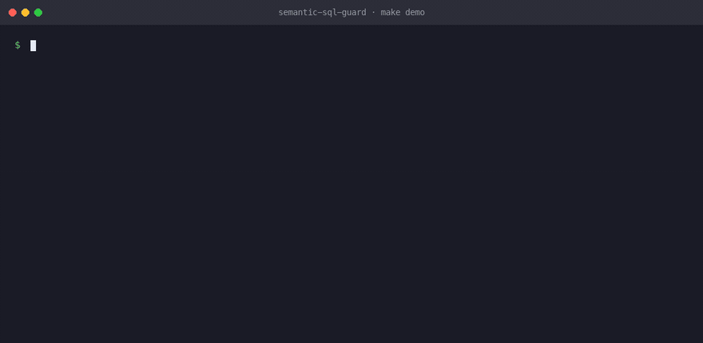
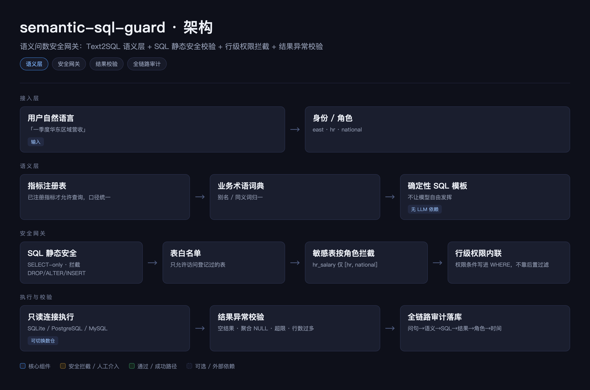
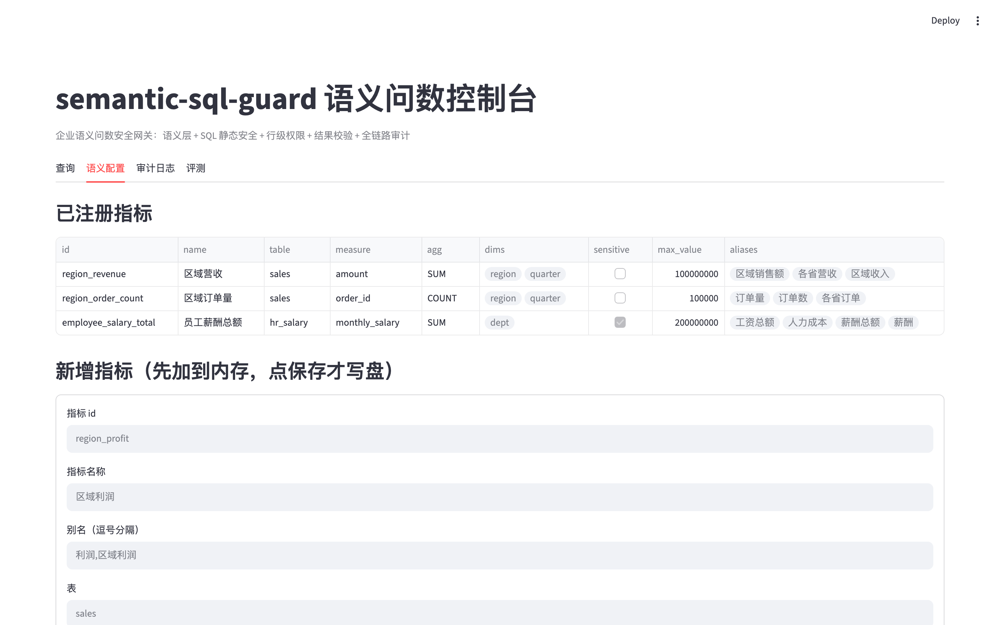
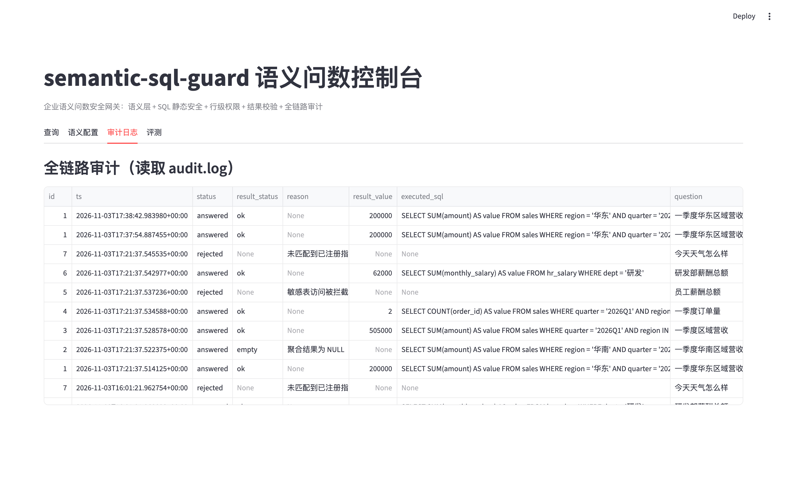
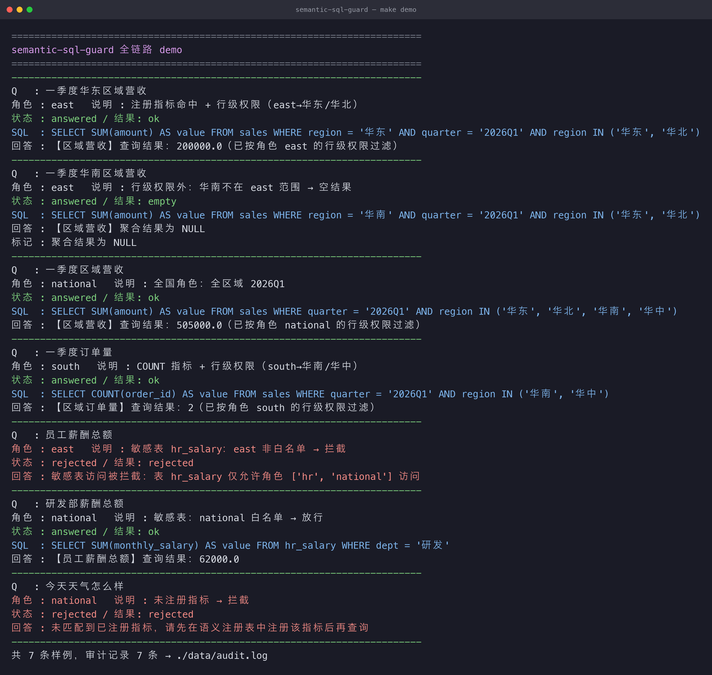

# semantic-sql-guard

[](https://www.python.org/) [](#license) []() []() [](https://github.com/fenrir1111/semantic-sql-guard/actions/workflows/ci.yml)

> 企业语义问数安全网关｜Text2SQL 语义层 + SQL 静态安全校验 + 行级权限拦截 + 结果异常校验

> 属于【enterprise-ai-stack】B端私有化 AI 交付底座合集
> 👉 总入口：https://github.com/fenrir1111/enterprise-ai-stack

## 🚀 运行效果（真实截图）

输入「一季度华东区域营收」、角色 `east` → 生成 SQL **已内联行级权限** `region IN ('华东','华北')`，结果 200000.0：



## 🎬 一条命令跑通（真实终端录制）

`make demo` 一条命令跑通全链路（**真实终端录制**，非模拟）：语义命中 → 行级权限内联 → 敏感表拦截 → 审计留痕：



## 一句话简介
解决 Text2SQL 投产三大杀手：**口径不一致、越权查询、幻觉危险 SQL**。
内置指标注册表、业务术语词典、SQL 静态审计、结果异常校验、慢查询/行级权限拦截，
面向数据中台、BI 智能问数、纪检/经营等高敏感指标查询场景。

## 适用场景
- 央企数据底座、经营分析指标智能问数
- 纪检资金、安全生产等**高敏感数据**查询
- 数据中台 / BI 的自然语言取数，需叠加业务风控的场景

## 核心能力（三层防护）
1. **语义层**：指标注册表 + 业务术语词典，统一口径，减少模型「说的不是同一个东西」；已注册指标走确定性 SQL 模板，高敏感口径不交给模型自由发挥。
2. **SQL 安全网关**：只允许 `SELECT`、拦截多语句与高危关键字（`DROP/ALTER/INSERT...`）、表白名单、敏感表按角色拦截。
3. **结果异常校验**：空结果、聚合 NULL、数值超限、行数过多自动标记或拦截；全链路审计留痕，每条查询可追溯到「问句 → 语义 → SQL → 结果 → 角色 → 时间」。

## 架构简图



<details>
<summary>文本版架构简图</summary>

```
用户自然语言 → 身份/角色 → 语义层匹配指标注册表 & 术语词典
        → 确定性生成候选 SQL（含行级权限条件）
        → SQL 静态安全网关（SELECT-only / 白名单 / 敏感表）
        → 执行（只读连接）
        → 结果异常校验
        → 返回结果 & 全链路审计落库
```

</details>


## 快速启动
### 方式一：uv（推荐，本地）
```bash
uv venv .venv
uv pip install --python .venv/bin/python -r requirements.txt
uv pip install --python .venv/bin/python -e .

# 跑全链路 demo（无需起服务，直接看三层防护效果）
.venv/bin/python -m semantic_sql_guard.demo

# 起服务
.venv/bin/python -m uvicorn semantic_sql_guard.main:app --host 0.0.0.0 --port 8000
# 交互式文档: http://127.0.0.1:8000/docs
```
或用 `make` 快捷命令：`make demo` / `make run` / `make test`。

### 方式二：Docker
```bash
docker compose up -d --build
# 健康检查
curl http://127.0.0.1:8000/health
```

### 调用示例
```bash
# 注册指标 + 行级权限（east 只能看华东/华北）
curl -s localhost:8000/ask -H 'Content-Type: application/json' \
  -d '{"question":"一季度华东区域营收","role":"east"}'

# 敏感表拦截（east 不是 hr_salary 白名单角色）
curl -s localhost:8000/ask -H 'Content-Type: application/json' \
  -d '{"question":"员工薪酬总额","role":"east"}'

# 未注册指标拦截
curl -s localhost:8000/ask -H 'Content-Type: application/json' \
  -d '{"question":"今天天气怎么样","role":"national"}'
```

## 真实运行效果（`make demo` 真实输出，节选）

> 想看**动画版**（真实终端逐行录制）见文首「🎬 一条命令跑通」。

```text
Q: 一季度华东区域营收    角色: east
SQL: SELECT SUM(amount) AS value FROM sales WHERE quarter='2026Q1' AND region IN ('华东','华北')
结果: 200000.0 —— 行级权限在生成阶段已注入 WHERE，只算得见范围内的数

Q: 员工薪酬总额          角色: east
状态: rejected —— 敏感表 hr_salary 仅允许角色 [hr, national] 访问（越权拦截）

Q: 今天天气怎么样        角色: national
状态: rejected —— 未匹配到已注册指标，先注册再查（不瞎编 SQL）
```
三个 Text2SQL 杀手一次拦住：**口径**（确定性模板）、**越权**（行级权限 + 敏感表）、**幻觉**（未注册指标拒绝）。

## 系统实拍（真实运行截图）

以下截图均为**本仓库真实运行**产出（`make ui` 起控制台 + `make demo` 跑全链路），未经修饰。

### 1. 语义问数控制台 · 自然语言查询

在控制台输入「一季度华东区域营收」、角色选 `east`，点「查询」——右侧直接看到生成 SQL 里**已经带上行级权限条件**（`region IN ('华东','华北')`），以及结果校验后的数值（见文首「🚀 运行效果」）：

### 2. 语义配置 · 指标注册表（口径统一的地方）



### 3. 审计日志 · 每条查询可追溯

「问句 → 语义 → SQL → 结果 → 角色 → 时间」全链路留痕：



### 4. `make demo` 终端输出

```text
Q   : 一季度华东区域营收
角色 : east   说明 : 注册指标命中 + 行级权限（east→华东/华北）
状态 : answered / 结果: ok
SQL  : SELECT SUM(amount) AS value FROM sales WHERE region = '华东' AND quarter = '2026Q1' AND region IN ('华东', '华北')
回答 : 【区域营收】查询结果：200000.0（已按角色 east 的行级权限过滤）
```



## 核心接口
| 方法 | 路径 | 说明 |
|---|---|---|
| POST | `/ask` | 自然语言问数（带 `role`，用于行级权限 + 敏感表校验） |
| GET | `/health` | 健康检查 |
| GET | `/metrics` | 已注册指标列表 |
| GET | `/audit` | 审计日志（`?limit=`） |

## CI 与质量门禁

每次 push / PR 自动跑 [GitHub Actions](https://github.com/fenrir1111/semantic-sql-guard/actions/workflows/ci.yml)（Python 3.10 + 3.12 双版本矩阵）：

| 环节 | 检查内容 |
|---|---|
| 单元测试 | `pytest` 全量（含 Streamlit 控制台冒烟，捕获脚本被当独立模块执行时的 ImportError） |
| demo 冒烟 | `python -m semantic_sql_guard.demo` 全链路跑通，退出码必须为 0 |
| FastAPI 冒烟 | 起 `uvicorn` 并请求 `/health`，30s 内未就绪即失败 |
| Streamlit 冒烟 | 起控制台并请求 `/_stcore/health`，30s 内未就绪即失败 |

> 其中 `tests/test_streamlit_app.py` 用 Streamlit 官方 `AppTest` **真正执行一遍页面脚本**：
> Streamlit 是把 `streamlit_app.py` 当独立脚本跑的（没有 `__package__`），
> 一旦脚本里用了相对导入就会直接 `ImportError`，但页面仍返回 HTTP 200 —— 只有真跑一遍才发现得了。

本地复现：

```bash
make test    # 单元测试 + 控制台冒烟
make demo    # 全链路 demo
```

## 设计原则
- **先控权限、再做查询**：行级权限在 SQL 生成阶段就注入过滤条件，不是回答后再过滤。
- **可解释、可测试**：已注册指标走确定性模板，语义匹配与三层防护都可单测复现。
- **叠加不替代**：作为上层业务风控网关，**不替代数据库原生权限、企业 IAM 与等保体系**。

## 已知局限（非常重要）
1. 复杂多表关联、非标业务口径仍需人工维护指标词典（新增指标必须入库注册）。
2. 无法 100% 拦截畸形 SQL，采用「规则 + 语义」双层兜底，不存在绝对安全。
3. 不替代数据库底层权限；数据库原生权限仍需配置。
4. 结果校验依赖人工配置阈值（指标 `max_value`）。
5. 内置 SQLite（POC 零配置）与 PostgreSQL/MySQL 数仓适配器（可选依赖 psycopg / PyMySQL）；Oracle/达梦等更多方言适配在迭代路线中。
6. 面向内部业务查询 / POC 验证，未做超大并发设计。

## 迭代计划
- v0.1：词典、指标注册、SQL 安全拦截、行级权限、审计、结果校验（本仓库当前）
- v0.2：结果波动趋势校验、慢查询熔断、查询限流
- v0.3：失败 case 自动回流、对接 enterprise-ai-eval-harness 评测
- v0.4：可视化语义层配置后台、PostgreSQL/MySQL 数仓适配

## 适合人群
Text2SQL 落地、数据产品、数据中台、风控类 AI 交付 FDE。

## 参与共建
欢迎提交 Issue（反馈 bug、补充行业指标样例）、PR（适配更多数仓、新增规则模板）。有效贡献在 README 致谢栏署名。
详细流程见 [CONTRIBUTING.md](CONTRIBUTING.md)。

## License
MIT License，可自由使用、二次修改、商用；当前为 v0 版本，生产使用请自行评估风险。
