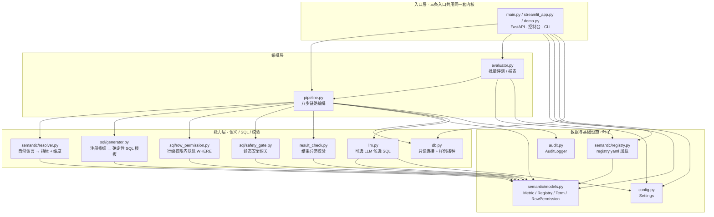

# 架构说明

## 请求全链路
```
POST /ask {question, role}
        │
        ▼
[1] 语义解析  semantic/resolver.py
    名称/别名最长命中 → 注册指标；术语词典 → 维度值
        │
        ▼
[2] 敏感表校验  pipeline.py
    指标所在表 ∈ sensitive_tables 且 role ∉ 白名单 → 拦截
        │
        ▼
[3] 行级权限  sql/row_permission.py
    按 role 注入 `region IN (...)` 条件（无该列则跳过；未配置角色→拦截）
        │
        ▼
[4] SQL 生成  sql/generator.py
    注册指标 → `SELECT agg(measure) FROM table WHERE 维度 AND 行权限条件`
        │
        ▼
[5] 静态安全网关  sql/safety_gate.py
    多语句 / 高危关键字 / 仅 SELECT / 表白名单 / 敏感表（sqlglot 解析 + 正则兜底）
        │
        ▼
[6] 执行  db.py
    只读连接（PRAGMA query_only）执行，返回 (列, 行)
        │
        ▼
[7] 结果校验  result_check.py
    空结果 / NULL / 数值超限 / 行数过多 → ok/empty/warn/rejected
        │
        ▼
[8] 审计  audit.py
    落 JSONL + 内存环形缓冲，返回结构化结果
```

## 模块划分
| 模块 | 职责 |
|---|---|
| `semantic/models.py` | 指标 / 术语 / 行权限 / 注册表 数据结构 |
| `semantic/registry.py` | 从 `registry.yaml` 加载注册表 |
| `semantic/resolver.py` | 自然语言 → 指标 + 维度过滤（确定性、可测试） |
| `sql/generator.py` | 注册指标 → 确定性 SQL 模板 |
| `sql/safety_gate.py` | 静态安全校验（sqlglot 解析 + 正则兜底） |
| `sql/row_permission.py` | 行级权限条件注入 |
| `result_check.py` | 结果异常校验 |
| `audit.py` | 全链路审计日志 |
| `db.py` | 数据访问 + 样例数据播种（默认 SQLite） |
| `llm.py` | 可选 LLM 候选 SQL（未注册指标兜底） |
| `pipeline.py` | 链路编排 |
| `main.py` | FastAPI 接口 |

## 模块依赖图

按**真实 import 关系**绘制（箭头 = 依赖方向，`A → B` 表示 A import B）。增删模块时请同步更新本节。



> 各包 `__init__.py` 只做 re-export，不在图内。

### 依赖不变量（改动时一并守住）

1. **`semantic/models.py` 是纯数据叶子**：Metric / Registry / Term / RowPermission 不依赖 DB、LLM 或任何 IO，语义层可独立单测。
2. **「生成什么 SQL」只由注册表数据决定**：`sql/generator.py` / `sql/row_permission.py` / `sql/safety_gate.py` 只依赖 `semantic/models.py`，**不反向依赖 `pipeline.py`**；编排层只决定顺序，不改变语义。
3. **`llm.py` 是可选旁路且只被 `pipeline.py` 引用**：未注册指标走确定性路径并安全拦截，LLM 不可用不影响主链路 —— 对应 `CONTRIBUTING.md` 里「不接受放宽 SQL 黑名单」的约定。
4. **权限与安全是两道互不依赖的工序**：`sql/row_permission.py` 把角色条件内联进 WHERE，`sql/safety_gate.py` 再做静态校验，任一模块都不能被另一层绕过或替代。
5. **`streamlit_app.py` 是唯一使用绝对导入的模块**（`sys.path` 自举，因为 Streamlit 以独立脚本执行），其余一律相对导入；整图 DAG 无环，40 个 pytest 不需要起服务、不需要外网。

### 扩展点

接真实数仓时替换 `db.py` 的只读连接即可；新增指标只改 `registry.yaml` 数据，不动 SQL 生成与网关逻辑。这也是「确定性优先、可降级」能成立的结构原因。

## 设计取向
- **确定性优先**：已注册指标走模板拼装，不交给模型自由生成 → 可解释、可单测。
- **叠加不替代**：本层是业务风控网关，不替代数据库原生权限 / 企业 IAM / 等保体系。
- **可降级**：LLM 为可选依赖，未安装或未开启时走确定性路径并安全拦截未注册指标。
- **可观测**：每条查询留痕（问句 → 语义 → SQL → 结果 → 角色 → 时间）。
